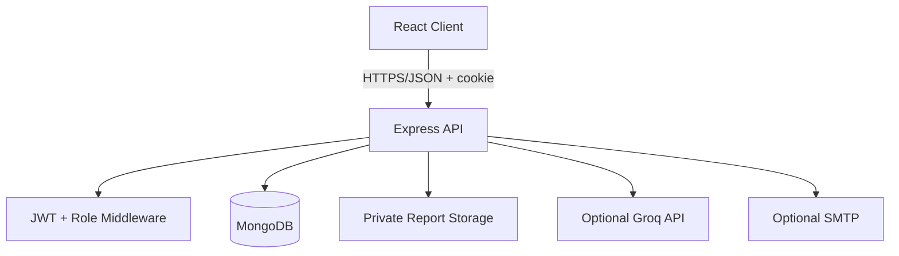

# Architecture

React/Vite browser client communicates with Express JSON API. Express uses Mongoose to access MongoDB. Authentication uses a signed JWT stored in an httpOnly cookie. Role checks run on the server. Uploaded report files are stored in `server/storage`, never in the public client directory, and downloads pass through an authorization endpoint.

## Environment
Secrets are loaded only by the backend from `server/.env`. Never commit `.env`, report files, tokens or real patient records.
